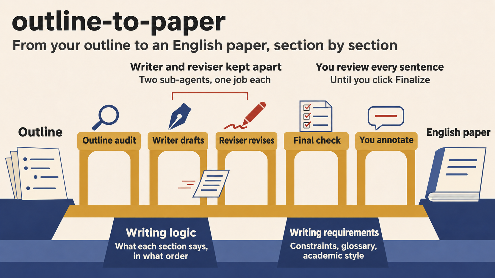

<div align="center">

# outline-to-paper

### Settled outline → logic audit, writer drafts, reviser revises, you annotate → English paper

**Writing logic decides what each section says and in what order; writing requirements decide how to write. With these two, your settled outline becomes an English paper, section by section, and you review every version sentence by sentence.**

[](#license-and-commercial-use)
[](#recommended-setup)
[](https://github.com/lancorrect/outline-to-paper/stargazers)

**Non-commercial use is permitted. Commercial use requires prior written permission.**

[中文](README_zh.md) | English

[Features](#features) · [Quick start](#quick-start) · [Installation](#installation) · [Recommended setup](#recommended-setup) · [Support](#support-this-project) · [Contributors](#contributors) · [License](#license-and-commercial-use) · [Acknowledgments](#acknowledgments)



</div>

> The rule files of the skill (`SKILL.md`, `references/`, `task_sheets/`) are written in English. The outline may be in any language; the paper is always written in English. Review notes and the annotation page follow the language you use with the agent.

## Features

### What it consists of

It consists mainly of two parts, writing logic and writing requirements, plus task sheets for sub-agents and two tools.

| Part | What it covers | What it includes |
|---|---|---|
| Writing logic | What each section says and in what order | One file each for the introduction, related work, preliminaries, method, abstract, experiments, conclusion, and captions. Each says which parts the section has, what each part says and how to check it, and ends with "Decide before writing". Also 14 criteria for auditing the logic of an outline, and the correspondences across sections |
| Writing requirements (general) | How to write, shared by every paper | Default constraints, optional presets, how to write the formulas of the method section, a phrasebank, and the academic style requirements of ml-paper-writing |
| Writing requirements (per paper) | This paper's own rules | Project constraints, glossary, section glossary and check-script word lists, created in your project from templates at the start |
| Task sheets | Work handed to sub-agents | Templates of four task sheets: outline logic audit, writer supplement list, writer, reviser |
| Tools | Checking and review | A check script that finds the problems a script can find; a local annotation page where you annotate sentences, paragraphs and the whole draft |

The writing requirements come in two kinds, and the writer, the reviser and the final check follow both at once: the constraints and the glossary keep the text on topic and correct; ml-paper-writing keeps the expression academically sound. Where they conflict, the constraints win, and the conflict is pointed out to you first.

### Workflow

After a one-time start, every section goes through this workflow. Each step's output is reviewed by you before the next step starts.

**Gather the material → outline logic audit → prepare → writer drafts → reviser revises → final check by the main agent → review → finalize**

| Step | Why | What it does |
|---|---|---|
| Start | Settle this paper's rules and the division of work | Creates the project constraints, the glossary and the check-script word lists from templates; asks you how sub-agents are started, which models the writer and the reviser use, which local papers may be searched during the audit, and which optional presets to enable |
| Gather the material | The outline is the only source of content | Saves the outline's original text without changing a word, so "outline line N" always refers to it; collects the outline's citation marks into a reference table, and only works in that table may be cited |
| Outline logic audit | Find the hard flaws of the outline before writing | First asks this section's "Decide before writing"; the main agent and a sub-agent audit independently, then cross-check; only hard flaws and missing design rationale are recorded, not order or wording |
| Prepare | Consistent wording across the paper | Checks every word in this section's outline against the glossary and asks you about anything unsettled; makes the section glossary, marking the same word separately for each concept |
| Writer drafts | Academic prose from the outline | When the outline is too brief to write from, first hands you a writer supplement list to approve; the writer sub-agent writes by its task sheet, without translating sentence by sentence, sorts sentences beyond the outline by the rules, and lists those that need your approval |
| Reviser revises | A second pair of eyes against the outline | A reviser sub-agent in another session, which does not see the writer's notes, checks the content against the outline and the rules, revises the expression by ml-paper-writing, and maps the outline and the draft in both directions |
| Final check by the main agent | One more pass before you see it | Runs the check script; reads the draft against the outline sentence by sentence for content, claim strength, the writing logic and ml-paper-writing's requirements; checks the correspondences with sections already written; collects what you need to decide |
| Review | You have the final say | You annotate sentence by sentence on the local annotation page; the next version marks which annotation each change answers; annotations ticked "Apply from now on" become rules in the project constraints or the glossary |
| Finalize | Keep the outline and the text in line | Lists the differences between the final text and the outline for you to review; the outline changes only after you approve |

**These points are always decided by you, never by the agent**: the answers at the start, "Decide before writing", the problems found in the outline logic, the writer supplement list, pending glossary entries, every version of the text, finalizing, and every change to the outline.

## Quick start

After installation, open Claude Code in the folder of your paper project and start a task in plain language.

### 1. Start

```text
Use outline-to-paper to start writing this paper. The outline is under outline/.
```

The agent creates the project constraints, the glossary and the check-script word lists from the templates, then asks you a few things: how sub-agents are started, which models the writer and the reviser use, which local papers may be searched during the audit, and which optional presets to enable. It asks only once per paper.

### 2. Write a section

```text
Write the introduction from the outline.
```

The agent first asks this section's "Decide before writing", then audits the outline logic, places the problems next to the outline's original text, and gives you the address of a local annotation page. After you have annotated it and the outline is fixed, it checks the glossary, dispatches the writer and the reviser, runs the final check and hands you the first version.

### 3. Annotate and get the next version

Annotate sentence by sentence on the annotation page and click "Submit". The agent receives your annotations on its own, produces the next version and marks every change on the page; annotations ticked "Apply from now on" become rules in the project constraints or the glossary. When you are satisfied, click "Finalize".

### 4. Finalize

After finalizing, the agent lists the differences between the final text and the outline for you to review, and changes the outline only after you approve. Then you can write the next section:

```text
Write the next section from the outline: related work.
```

### Folders

```text
<project>/
├── writing/                   # per-paper requirements (rules_dir): project constraints, glossary, check-script word lists
│   ├── drafts/                # every version handed to you, its review config and your annotations (drafts_dir)
│   └── final/                 # finalized sections (final_dir)
└── writing_work/<section>/    # process material: outline copy, reference table, task sheets, sub-agent output (work_dir); not for you to review
```

All folders can be changed in the configuration. The rules of each step are in [`SKILL.md`](SKILL.md), the writing logic in [`references/logic/`](references/logic/), and the writing requirements in [`references/requirements/`](references/requirements/).

## Installation

### Claude Code

```bash
# for all projects
git clone https://github.com/lancorrect/outline-to-paper.git ~/.claude/skills/outline-to-paper

# for the current project only
git clone https://github.com/lancorrect/outline-to-paper.git .claude/skills/outline-to-paper
```

### Configuration

In the skill folder, copy the configuration template and fill it in:

```bash
cp config.local.json.example config.local.json
```

`config.local.json` is the only file that holds paths on your machine. It is ignored by `.gitignore` and never committed. It holds the locations of the folders, the local paper folders that may be searched during the audit, the location of the implementation code, how sub-agents are started, and the models of the writer and the reviser. Each item is explained in the template, and the agent also asks you about each one at the start.

### Requirements

- **Python 3**: the check script and the annotation page use only the standard library; nothing else to install.
- **A browser** for the local annotation page. Formulas are rendered with KaTeX loaded from a CDN; offline, the formula source is shown instead.
- **A way to start sub-agents**: [Codex CLI](https://github.com/openai/codex) is recommended for the writer; for the reviser you can use the sub-agents built into Claude Code, or a separate Claude Code session.

## Recommended setup

| Role | Recommended | What it does |
|---|---|---|
| Main agent | Claude Code | Talks with you, gathers the material, audits the outline logic, runs the final check, starts the local annotation page, processes annotations |
| Writer | GPT, through Codex | Writes the outline into English text by its task sheet |
| Reviser | Claude | Checks the content against the outline and the rules, and revises the expression by ml-paper-writing |

The workflow is written for several agents; please run it that way. The writer and the reviser must be two separate sessions, and every sub-agent is a new session with no memory.

## Support this project

If this project helps you write your papers, please give it a Star on GitHub. Feel free to pass it on to anyone who is writing a paper; the more Stars it has, the easier it is for them to find.

If you run into a problem or have an idea for improvement, please open an [Issue](https://github.com/lancorrect/outline-to-paper/issues).

## Contributors

<a href="https://github.com/lancorrect"></a>

## License and commercial use

**Non-commercial use is permitted. Commercial use requires prior written permission.**

The parts written by the authors of this project are licensed under the [PolyForm Noncommercial License 1.0.0](LICENSE).

- **Permitted**: personal learning and research, teaching, non-commercial academic research, and use by educational institutions and public research organizations.
- **Needs a commercial license first**: business use in companies, paid services, and integration into commercial products. Please submit a [commercial license request](https://github.com/lancorrect/outline-to-paper/issues/new?title=Commercial%20license%20request) first.

Exception: [`references/requirements/ml-paper-writing/`](references/requirements/ml-paper-writing/) is an unmodified copy of a third-party skill under the MIT License. The license above does not apply to it; see the `LICENSE` and `SOURCE.md` files in that folder.

## Acknowledgments

- **[AI-Research-SKILLs](https://github.com/Orchestra-Research/AI-Research-SKILLs)** (Orchestra Research): ml-paper-writing in the writing requirements is one of its skills, included unmodified; the academic style requirements all come from it.
