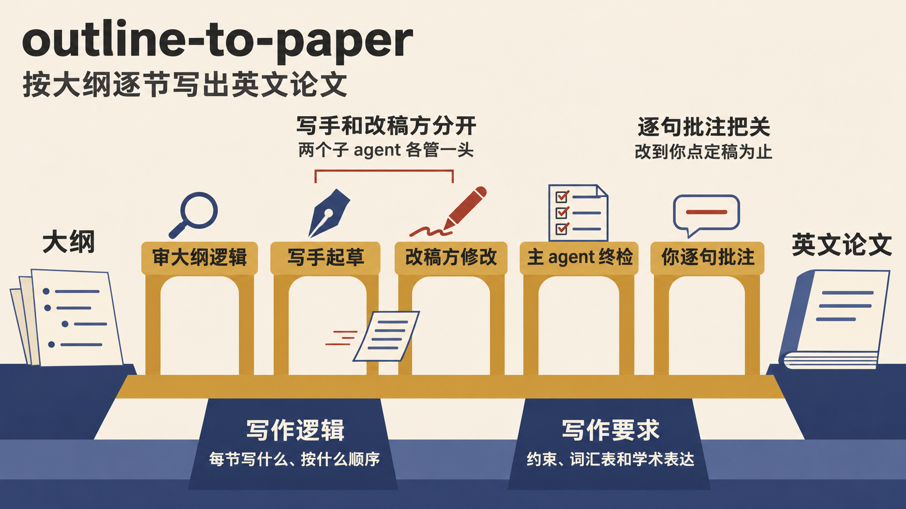

<div align="center">

# outline-to-paper

### 定好的大纲 → 审逻辑、写手起草、改稿方修改、逐句批注 → 英文论文正文

**写作逻辑定每节写什么、按什么顺序写，写作要求定怎么写：靠这两样，把你定好的大纲逐节写成英文论文，每一版都由你逐句批注把关。**

[](#license-and-commercial-use)
[](#推荐配置)
[](https://github.com/lancorrect/outline-to-paper/stargazers)

**允许非商业使用。商业使用须事先获得书面授权。**

中文 | [English](README.md)

[功能](#功能) · [快速开始](#快速开始) · [安装](#安装) · [推荐配置](#推荐配置) · [支持本项目](#支持本项目) · [贡献者](#贡献者) · [License](#license-and-commercial-use) · [致谢](#致谢)



</div>

> skill 的规则文件（`SKILL.md`、`references/`、`task_sheets/`）用英文写成。大纲可以是任何语言，论文正文一律是英文；交审说明和批注页界面跟你和 agent 对话的语言走。

## 功能

### 由什么组成

主要由写作逻辑和写作要求两部分组成，另外有子 agent 的任务书和两个工具。

| 部分 | 管什么 | 包括 |
|---|---|---|
| 写作逻辑 | 每节写什么、按什么顺序写 | 引言、相关工作、预备知识、方法论、摘要、实验、结论、表题与图注各一份，每份写这一节由哪几部分组成、各写什么、怎么检查，文末列出“写之前要定的事”；审大纲逻辑的 14 条判据；跨节对应关系 |
| 写作要求（通用） | 怎么写，所有论文共用 | 默认约束、可选预设、方法论公式的写法、句式库，以及 ml-paper-writing 的学术表达要求 |
| 写作要求（本文专用） | 这篇论文自己的规则 | 项目约束、全文词汇表、章节词汇对照表、脚本检查词表，开局时从模板建在你的项目里 |
| 任务书 | 派给子 agent 的活 | 审大纲逻辑、写手补充清单、写手、改稿方四份任务书模板 |
| 工具 | 检查和交审 | 检查脚本扫出能用脚本查的问题；本地批注页让你逐句、逐段、对全文批注 |

写作要求里有两类要求，写手、改稿方和终检三方同时遵守：约束和词汇表保证不跑题、内容正确；ml-paper-writing 保证表达合乎学术规范。两者冲突时按约束，并先向你指出。

### 流程

开局一次，之后每一节都走这条流程，每一步的产物都要你审过才进入下一步：

**取材料 → 审大纲逻辑 → 写前准备 → 写手起草 → 改稿方修改 → 主 agent 终检 → 批注交审 → 定稿**

| 流程 | 目的 | 功能 |
|---|---|---|
| 开局 | 定好这篇论文的规则和分工 | 从模板建项目约束、全文词汇表和脚本检查词表；问你子 agent 怎么开、写手和改稿方用什么模型、审逻辑时可以查哪些本地论文、可选预设启不启用 |
| 取材料 | 内容只有大纲一个来源 | 大纲原文一字不改存一份，之后说“大纲第几行”都指它；从大纲的引用标记汇总引用表，只许引用表里的文献 |
| 审大纲逻辑 | 写之前先把大纲的硬伤找出来 | 先问本节“写之前要定的事”；主 agent 和一个子 agent 各自独立审，再交叉核对；只抓硬伤和设计理由缺失两类，不挑顺序和措辞 |
| 写前准备 | 用词全文统一 | 本节大纲的用词逐个对照全文词汇表，没定的先问你；做本节的章节词汇对照表，同一个词按概念分开标 |
| 写手起草 | 照大纲写成学术正文 | 大纲写得简、照着写不成正文时，先出写手补充清单交你批；写手子 agent 按任务书写，不逐句硬译，大纲之外的句子按规则分档，要你批的列出来 |
| 改稿方修改 | 第二双眼睛对照大纲查 | 另一个会话的改稿方子 agent 不看写手的说明，只按大纲和规则查内容、按 ml-paper-writing 改表达，做大纲和稿子的双向对应 |
| 主 agent 终检 | 交给你之前再过一遍 | 跑检查脚本；逐句对照大纲查内容、语气强度、写作逻辑和 ml-paper-writing 的要求；查和已写好各节的对应关系；汇总要你定的事 |
| 批注交审 | 你说了算 | 在本地批注页上逐句批注，下一版标出每处改动对应哪条批注；勾了“以后都这样”的批注会被总结成规则，写进项目约束或词汇表 |
| 定稿 | 大纲和正文保持一致 | 列出定稿和大纲不一致的地方交你审，你批了才改大纲 |

**以下节点必须由你确认，agent 不自行决定**：开局的答案、写之前要定的事、大纲逻辑的问题、写手补充清单、词汇表的待定项、每一版正文、定稿、对大纲的每一处修改。

## 快速开始

安装完成后，在论文所在的项目目录里打开 Claude Code，用自然语言发起任务。

### 1. 开局

```text
使用 outline-to-paper，开始写这篇论文，大纲在 outline/ 下。
```

Agent 从模板建好项目约束、全文词汇表和脚本检查词表，再问你几件事：子 agent 怎么开、写手和改稿方用什么模型、审逻辑时可以查哪些本地论文、可选预设启不启用。每篇论文只问一次。

### 2. 写一节

```text
按大纲写引言。
```

Agent 先问这一节“写之前要定的事”，再审大纲逻辑，把问题挂在大纲原文旁边，给你一个本地批注页的网址。你批完、大纲改好以后，它对照词汇表、派写手和改稿方，终检后把第一版交给你。

### 3. 批注、出下一版

在批注页上逐句批注，点“提交”。Agent 自动收到批注，改出下一版，页面上标出每一处改动；勾了“以后都这样”的批注，它总结成规则写进项目约束或词汇表。满意了就点“定稿”。

### 4. 定稿

定稿以后，agent 列出定稿和大纲不一致的地方交你审，你批了才改大纲。然后就可以写下一节：

```text
按大纲写下一节，相关工作。
```

### 目录

```text
<项目>/
├── writing/                   # 本文专用要求（rules_dir）：项目约束、全文词汇表、脚本检查词表
│   ├── drafts/                # 每一版交审的稿子、审稿配置和你的批注（drafts_dir）
│   └── final/                 # 定稿（final_dir）
└── writing_work/<节名>/       # 过程材料：大纲副本、引用表、任务书、子 agent 的产出（work_dir），不用你审
```

目录都可以在配置里改。各步的规定见 [`SKILL.md`](SKILL.md)，写作逻辑见 [`references/logic/`](references/logic/)，写作要求见 [`references/requirements/`](references/requirements/)。

## 安装

### Claude Code

```bash
# 所有项目可用
git clone https://github.com/lancorrect/outline-to-paper.git ~/.claude/skills/outline-to-paper

# 仅当前项目可用
git clone https://github.com/lancorrect/outline-to-paper.git .claude/skills/outline-to-paper
```

### 配置

在 skill 目录里复制配置模板并填写：

```bash
cp config.local.json.example config.local.json
```

`config.local.json` 是唯一存放本机路径的文件，已被 `.gitignore` 忽略，不会入库。里面要填各个目录的位置、审逻辑时可查的本地论文文件夹、实现代码的位置、子 agent 怎么开，以及写手和改稿方用的模型。每一项的说明都写在模板里。开局时 agent 也会逐项问你。

### 依赖

- **Python 3**：检查脚本和批注页只用标准库，不用另装包。
- **浏览器**：打开本地批注页。公式渲染从 CDN 加载 KaTeX，离线时显示公式原文。
- **开子 agent 的工具**：写手推荐用 [Codex CLI](https://github.com/openai/codex)；改稿方可以用 Claude Code 自带的子 agent，或者另开一个 Claude Code 会话。

## 推荐配置

| 角色 | 推荐 | 做什么 |
|---|---|---|
| 主 agent | Claude Code | 和你沟通、取材料、审大纲逻辑、终检、起本地批注页、处理批注 |
| 写手 | GPT，经 Codex | 按任务书把大纲写成英文正文 |
| 改稿方 | Claude | 对照大纲和规则查内容、按 ml-paper-writing 改表达 |

流程是按多 agent 写的，请用多 agent。写手和改稿方必须是两个分开的会话，子 agent 都是新会话，不带记忆。

## 支持本项目

如果本项目对你写论文有帮助，欢迎在 GitHub 点一个 Star。也欢迎转给正在写论文的同学，Star 越多，需要它的人越容易找到。

使用中遇到问题或有改进建议，请提交 [Issue](https://github.com/lancorrect/outline-to-paper/issues)。

## 贡献者

<a href="https://github.com/lancorrect"></a>

## License and commercial use

**允许非商业使用。商业使用须事先获得书面授权。**

本项目作者撰写的部分采用 [PolyForm Noncommercial License 1.0.0](LICENSE)。个人学习与研究、教学、非商业学术研究，以及教育机构和公共研究机构的使用，均在许可范围内。企业业务使用、付费服务和集成到商业产品，须先提交[商业授权申请](https://github.com/lancorrect/outline-to-paper/issues/new?title=%E5%95%86%E4%B8%9A%E6%8E%88%E6%9D%83%E7%94%B3%E8%AF%B7)。

例外：[`references/requirements/ml-paper-writing/`](references/requirements/ml-paper-writing/) 是第三方 skill 的原样副本，采用 MIT 许可，不适用上面的许可，见该目录里的 `LICENSE` 和 `SOURCE.md`。

## 致谢

- **[AI-Research-SKILLs](https://github.com/Orchestra-Research/AI-Research-SKILLs)**（Orchestra Research）：写作要求里的 ml-paper-writing 是它的一个 skill，原样收录，学术表达的要求都来自它。
